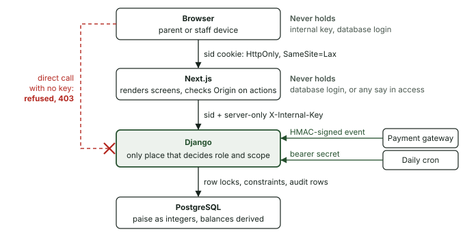
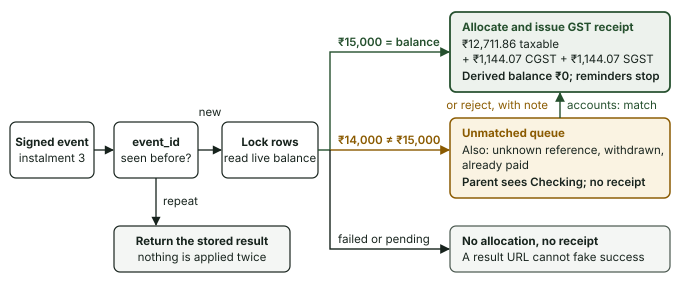
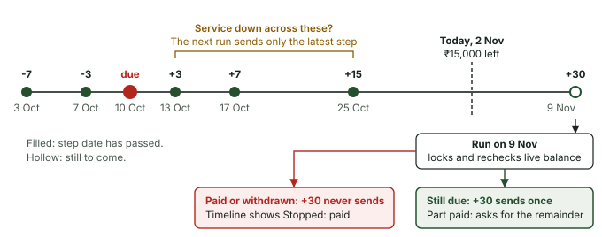
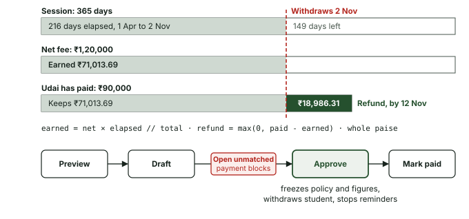
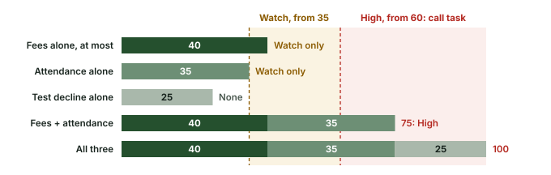
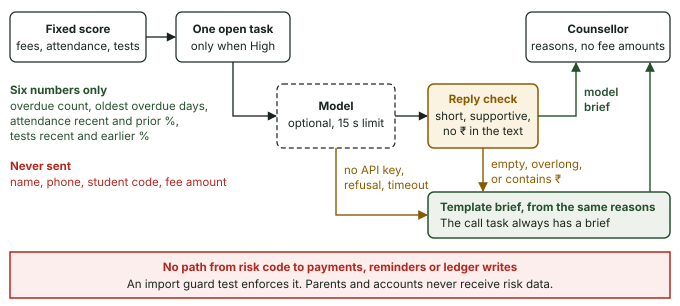
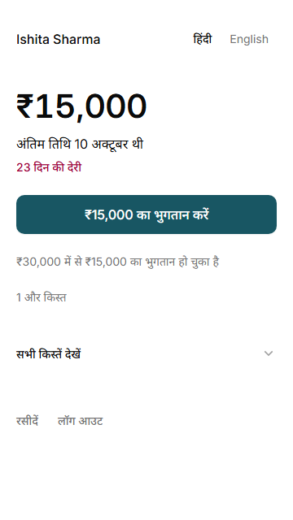
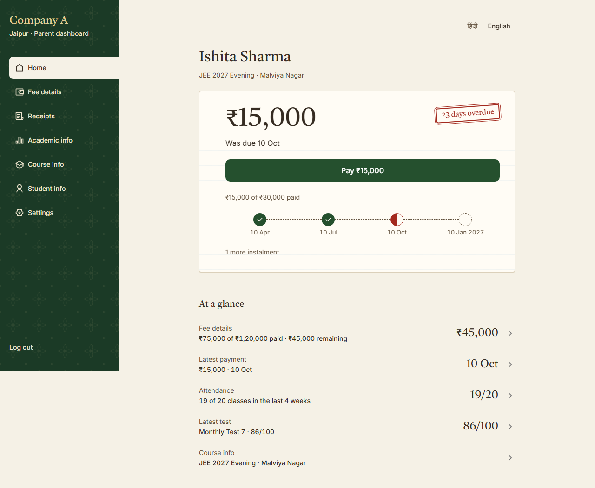
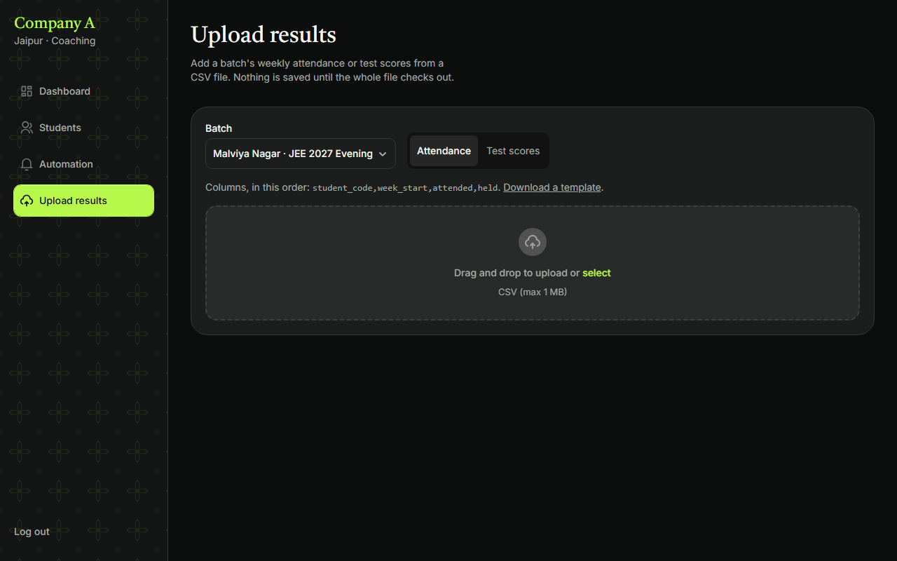
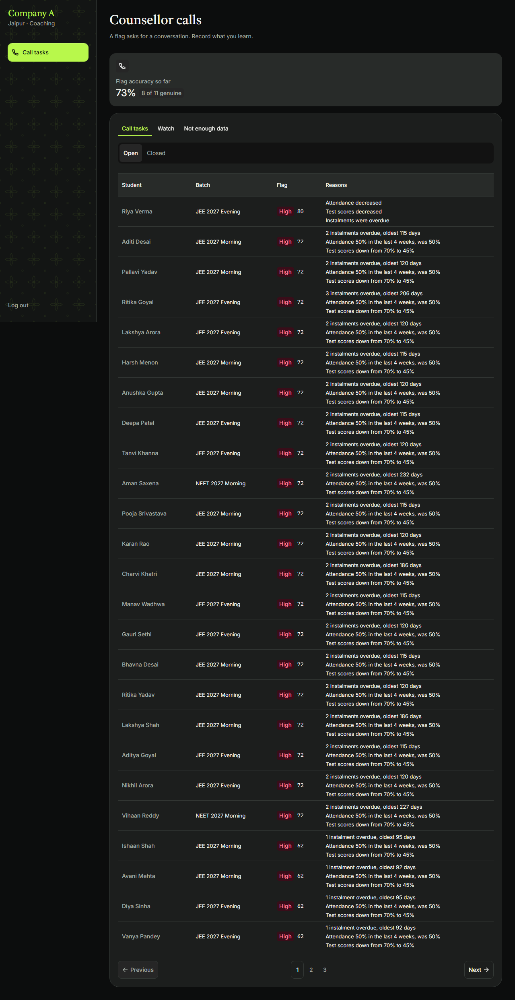

Repository: https://github.com/UdaiBatta/Isocode-portal

Live application: `<LIVE_URL>`

# Coaching Fees: technical design document

Company A, Jaipur needs parents to see and pay dues, and accounts staff to follow up without chasing money already received. This app joins those views around one allocation ledger. It runs locally with real Django sessions and PostgreSQL. Payments, OTP delivery and messages are demonstrations. No live deployment is claimed. All seeded people and contacts are fictional.

## Problem and business case

These figures are the brief's business assumptions, not measured savings.

| Item | Working | Result |
| --- | --- | ---: |
| Annual billing | 2,600 × ₹1,20,000 | ₹31.2 crore |
| Never collected | 2% × ₹31.2 crore | ₹62.4 lakh |
| Chasing cost | 8 staff at half time = 4 FTE × ₹4.2 lakh | ₹16.8 lakh |
| Annual loss | ₹62.4 lakh + ₹16.8 lakh | ₹79.2 lakh |
| Over 60 days late | 12% × ₹31.2 crore | ₹3.744 crore |
| At the 6% target | 6% × ₹31.2 crore | ₹1.872 crore |

Moving from 12% to 6% brings ₹1.872 crore in on time, separate from recovered bad debt and staff time. A ₹6 lakh build pays back in about 0.91 months if all the annual loss is recovered, or 1.82 months at half recovery. Both exclude hosting, gateway and messaging costs, which the brief does not supply.

The dashboard shows over-60-days value against the 6% target. Its numerator includes unpaid value older than 60 days and allocations paid over 60 days late; its denominator is all past-due billed value. The app cannot prove 70% fewer parent calls without a call baseline; portal/pay-link use are only proxies. The unmatched queue and exports support four-day-to-one-day reconciliation, but proof needs a timed pilot. A six-week rollout would pilot one centre, import fee-software/Excel data, run alongside Tally for a month, then extend to the other three centres.

## Architecture and why

*Each layer holds only what it needs. A browser that skips Next.js has no key, so Django refuses it. The gateway and the cron job reach Django with their own secrets.*

Next.js 16, React 19 and BoardUI render the interface. Pages use `lib/data`, actions use `lib/actions`, and `lib/backend.ts` forwards the session and server-only internal key to Django. The browser calls Next.js, keeping database credentials and the internal key out of browser code. Django 5.2 LTS on Python 3.14 owns auth, permissions, validation, migrations, money transactions, reminders and risk. PostgreSQL supplies constraints and durable history. Local verification uses PostgreSQL 18; CI specifies PostgreSQL 17.

Django provides migrations, transactions with row locks, sessions and password hashing, so money and access code stand on tested parts. The cost is two applications to run/deploy and an extra network call per page. Both services may start cold.

A queue was rejected because reminders derive from current balances at send time. Existing CSS/SVG academic charts avoid a chart dependency. Django sessions avoid an auth library. Vercel Services was not adopted; deployment is planned as two independently configured apps plus PostgreSQL, and remains unverified.

Prototype fixtures/cookies, `/proto`, preview-state parameters and `NEXT_PUBLIC_PROTO` are removed. Demo controls now invoke guarded Django operations. Only unrestricted accounts can change the shared demo date or reset twelve named examples. Reset preserves audits/counters; it is not a full database reset.

## Data model and invariants

| Group | Records |
| --- | --- |
| Organisation | Centres, batches, students; course/stream/session live inside batches |
| Access | Guardians, guardian/student links, staff, OTP challenges, login attempts, sessions, consents |
| Money | Refund policies, fee plans, instalments, payments, allocations, receipts, counters, gateway events |
| Exceptions | Unmatched payments, reminder logs, frozen refund calculations |
| Support | Weekly attendance, test scores, risk flags, counsellor tasks |
| Accountability | Audit log and application settings, including demo today |

Money is integer paise, displayed through `lib/format.ts`. The `instalment_balances` view derives paid/outstanding values from allocations; no mutable student balance is stored. Dates are `datetime.date` in Django and `YYYY-MM-DD` in JSON. Only `backend/fees/clock.py` decides today; demo today is 2 November 2026 unless changed through its guarded control.

Pure domain rules have no database, network or clock imports. Services lock students and money records, recheck scope after waiting and audit the transaction. Events are idempotent; receipt counters increment transactionally. Archive retains history; protected history prevents deletion. Admin edits cannot rewrite paid allocations/receipts. Audited reductions may make unpaid instalments zero, but net fees cannot fall below money already allocated.

## Main flows

### Pay and reconcile

*One ₹15,000 event for Ishita. The amount is compared with the balance read under lock, so only an exact match issues a receipt. The balance is never stored: it is derived from allocations.*

Opaque public links expose minimal information. A result parameter cannot manufacture success. Private receipts need a linked, consented guardian or scoped accounts staff. Failed attempts issue no receipt; wrong/ambiguous payments show Checking. Counter payments allocate oldest first. Included GST is assumed at 18%: integer arithmetic rounds taxable value half up, then splits GST so all three parts equal the payment.

### Remind from current facts

*Ishita's third instalment, to scale. The schedule is fixed, but each send rereads the live balance, so a payment stops every later step. A unique instalment and step pair prevents duplicates.*

Steps are -7, -3, 0, +3, +7, +15 and +30 days. After an outage only the latest eligible unsent step is used. Part payments keep reminders on the remainder. A unique instalment/step prevents duplicates. The timeline explains sent, upcoming and stopped states. Pre-login reminders assume enrolment-paperwork consent; portal data still requires recorded consent.

### Refund

*A worked example using Udai. The bars share one scale, so the withdrawal date lines up with what has been earned. The figures match the brief's sample withdrawal, which the seeded app shows as Aarav.*

Policy v1 assumes daily pro-rata on net fees, no deduction and ten calendar days. Inclusive elapsed days are clamped to the session. Earned fee is `net_paise × elapsed_days // total_days`; refund is `max(0, paid_paise - earned_paise)`. Still-payable value is separate. No editable total bypasses the formula. A related open unmatched payment blocks approval. Approval freezes policy/figures, withdraws the student and stops reminders. The worked example above returns ₹18,986.31, matching the brief's supplied 2 November example. The client's real policy must replace this assumption before real use.

### Support flag

*The most each signal can add. No single signal reaches High, so a call task always needs at least two kinds of evidence.*

Risk never writes payments or reminders. Parents/accounts receive no risk data. Counsellors receive support reasons without fee amounts.

## How the AI works

This is a hand-set policy, not a trained dropout predictor. Fee points cap at 40, attendance at 35 and test decline at 25. High starts at 60; Watch at 35. One signal cannot reach High. Fewer than four valid attendance weeks or three tests gives “Not enough data.” Attendance compares recent four weeks with prior four when available; tests compare the last two with earlier results in the latest five. Pure tests fix rounding/boundaries.

High may create one open task. Trigger facts remain separate from later assessments. False flag suppresses another task for 30 days unless score rises by at least 15. Outcomes allow correction; scores never initiate collection or decide refunds.

*The model is optional and sees only six numbers. Every failure ends in the template, so the counsellor's task never depends on it.*

Optional wording receives six allowlisted numeric features: overdue count, oldest overdue days, recent/prior attendance and recent/earlier test percentages. No names, phones or fee amounts are sent. Structured output must be a short supportive brief. Failures, refusals, empty/overlong or rupee-containing responses use the template. Calls have a 15-second timeout and one retry; a task caches its brief.

**No `ANTHROPIC_API_KEY` is configured. Briefs use the template fallback unless a deployment sets a key.** The pinned SDK has offline HTTP-mock/parser coverage; no live-provider quality/latency result is claimed.

Thirty developer-labelled synthetic cases give TP 10, FP 0, FN 0, TN 20: precision/recall 1.00 on authored policy expectations. They cover single-signal caps, 59/60, day 15/16, settled balances and insufficient history. This is regression evidence, not real predictive performance. Initial counsellor accuracy also uses fictional outcomes. A pilot needs observed outcomes and missed-concern review before changing weights.

## UI and design decisions

Parents see amount, date and one next action before secondary detail. Paper surfaces, forest actions and bilingual ledger typography support this order; desktop navigation becomes a four-item phone bar. Accounts gets graphite/lime panels, ageing, filters, ledgers and reconciliation. Admin has audited master-record save/archive/restore/delete.

Parent copy uses Hindi (हिन्दी) and English dictionaries. Inter, Noto Sans Devanagari, Tiro Devanagari Hindi and IBM Plex Mono are served locally after build. Parent motion is CSS only with reduced-motion support. Staff motion confirms changed totals. Native disclosures and a read-only BoardUI-styled receipt table keep parent scripts within budget. Loading/empty/error states retain role navigation.

*Parent dues: amount and payment action precede secondary detail.*

*Outstanding value, ageing and drill-down share one ledger source.*

*Row-level validation precedes an all-or-nothing save.*

*Support reasons and outcomes stay separate from accounts work.*

Five-second findings: `<GATE_0_RESULTS>`. Real-phone, Hindi-reader and five-second tests were **not run**. No findings or changes are attributed to them. The human can update this before submitting. Automated viewports/font/accessibility checks do not replace them.

## Depth features

Academic upload at `/staff/upload` validates exact CSV headings, UTF-8 text up to 1 MB, at most 5,000 rows, dates and ranges. Next.js allows a 2 MB action envelope for encoding overhead; Django retains the 1 MB file limit. Django checks accounts role, active batch/student membership and centre scope. Check-only does not write. Commit atomically upserts accepted rows and one audit. Attendance keys are student/week_start; test keys are student/test_date/test_name. Last repeated key wins. These overwrite semantics are assumptions.

Tally uses the scoped current-backend-month receipts, like CSV, including archived history. An ENVELOPE contains one Receipt voucher per receipt. Party names use student code/name; counterpart ledgers are Cash or Bank. Integer-paise entries balance; narration carries tax parts. Ledger names must match the receiving company. **Tally XML has never been tried in a real Tally installation.**

## Testing and security

The directory commit's check passed 52 frontend and 186 Django tests, zero failures/skips. Lint has three existing warnings; types, Ruff and Django checks pass. Tests cover money/dates, idempotency, refund snapshots/rollback, reminder locks, audits, scope, OTP limits, uploads and risk isolation. The access test walks every registered URL and rejects missing guards, with explicit webhook/cron exceptions.

Screenshots use real sessions and an isolated snapshot at 360×640 and 1280×800 in both languages. The snapshot cannot change the human's shared database.

Django uses only SecurityMiddleware, SessionMiddleware and CommonMiddleware. **CSRF middleware is intentionally off:** Next.js server actions check Origin/Host, the cookie is HttpOnly and SameSite=Lax (Secure for HTTPS APP_URL), and Django requires server-only `X-Internal-Key`. The browser must not receive that key or call Django directly. Webhooks use HMAC; cron uses its bearer secret. Deployment/new endpoints must preserve this boundary.

Roles/scope come from current database records, never client role values. Parents need consent and a linked non-archived child. Academic reads respect enrolment/today/withdrawal. Admin has no implicit accounts/counsellor access. CSV neutralises formula-like text. Secrets/submission output stay ignored. This is not a penetration test or compliance certification; minor-data/consent interpretation needs legal review.

### Final acceptance evidence

The full browser suite ran once on a production build of the final application code (`bed736f`), against an isolated database snapshot, at 360×640 and 1280×800: **253 passed, 0 failed, 5 skipped** in 27 minutes. All five skips are deliberate one-viewport tests. `e2e/golden.spec.ts` passed at 360 px in Hindi: real OTP, consent, dues, payment and receipt, then accounts sees the reminder stopped and total outstanding exactly ₹15,000 lower.

One earlier full run had a single timeout, the phone-width payment queue search. It passed three times alone and in the final run, but its cause was not confirmed.

Fresh-clone setup passed on a new database: `npm ci`, a Python 3.14 environment, `db:migrate`, `db:seed` (2,600 students) and Django's system check. That run did not start the servers and click through the app.

**Known intermittent browser error.** On phone-width screens, rapid full-page reloads that interrupt a streaming page can raise React's streaming runtime error (`$RS`, "reading 'parentNode'"). With no error filter, one run of 42 such reloads raised it 6 times and a second run of 42 raised it none. In the second run, 42 settled page loads and 60 tab switches also raised none, and desktop raised none in 42 rapid reloads and 28 rapid tab switches. No visible failure was observed, and pages kept working. The layout and parent-payment tests still ignore this exact error, so their clean-console result does not cover it. The cause is not confirmed, and payment was not exercised with the filter off.

## Assumption register

| ID | Assumption | Reason/consequence |
| --- | --- | --- |
| A1 | JEE four × ₹30,000; NEET three × ₹40,000 | ₹1.2 lakh average |
| A2 | Other due dates vary by centre | Only examples supplied |
| A3 | Earlier sample instalments were paid | One due row each supplied |
| A4 | Session 1 April 2026 to 31 March 2027 | Pro-rata needs dates |
| A5 | Refund v1: daily net pro-rata, no deduction, ten days | Actual policy not supplied |
| A6 | Withdrawal is written-notice receipt date | Objective date needed |
| A7 | Included 18% GST, CGST/SGST; sample GSTIN | Tax setup unspecified |
| A8 | Reminders -7, -3, 0, +3, +7, +15, +30 around 10:30 IST | Cadence unspecified |
| A9 | Part payment keeps reminders on remainder | Unpaid value needs follow-up |
| A10 | Demo today 2 November 2026 | Matches examples |
| A11 | Separate counsellor role | False-flag review without amounts |
| A12 | No student login | Parent/staff core scope |
| A13 | All students treated as minors | Consistent consent requirement |
| A14 | Hand-set weights/caps; High 60, Watch 35 | No outcome data |
| A15 | Unspecified people, batches, histories and outcomes fictional | Demo coverage, not evidence |
| A16 | Staff English only | Hindi concerns parents |
| A17 | Opaque pay links need no login | Fewer steps, minimal public data |
| A18 | DPDP s.9(3)/minor-data interpretation needs a lawyer | No legal conclusion claimed |
| A19 | Over-60 includes unpaid and late-paid value over past-due value | Formula unspecified |
| A20 | Pre-login reminders rely on enrolment-paperwork consent | Portal still needs recorded consent |
| A21 | Enrolment discounts split across instalments | Allocation rule unspecified |
| A22 | Three sample students in Malviya Nagar | Centre unspecified |
| A23 | React Bits in public app counts as application use | Licence interpretation open |
| A24 | Global Admin/Manage role | Human-requested extension |
| A25 | Courses represented inside batches | No separate catalogue required |
| A26 | Reuse batch schedule; empty batches space four JEE/three NEET dates | Invented policy; final instalment gets paise remainder |
| A27 | Primary guardian replacement changes that child's link; shared edits affect linked children | Shared identity semantics |
| A28 | Archive history-bearing records; centre codes immutable | Protect scope, receipts, audit |
| A29 | Audited fee reductions can create zero instalments | Approved override; no synthetic payment/receipt |
| A30 | Upload keys student/week or student/date/test-name; last key wins | Existing uniqueness defines upsert |
| A31 | Tally Receipt ENVELOPE, student party, Cash/Bank, tax narration | Layout not supplied/tested |
| A32 | Shared demo controls need unrestricted accounts | Organisation-wide effects |
| A33 | Unnamed refund examples/dates invented | Exercise policy without real people |

## Cuts, next work and honest limits

Gateway, SMS, WhatsApp and OTP delivery are mocked. No real provider, production deployment, Vercel cold-start or live cron invocation is verified. Deployment needs a private-window review and manual cron run.

Risk has no real-student validation. Refund/tax/enrolment-consent/import assumptions need approval. Real Tally and live model calls are unverified. Human phone/Hindi/five-second checks were not run: `<GATE_0_RESULTS>`. Browser viewports do not establish low-end hardware usability or professional Hindi quality.

Reminder tests cover seed/test volume, not production capacity inside the configured 60-second function limit. Reporting materialises scoped instalment IDs; review memory/query behavior well above 2,600 students. Automation still loads payment candidates; search redesign was deferred. Django stores usable session keys, so database access must be protected. Shared demo edits affect other reviewers; reset is explicit and restricted.

Parent progress, bulk upload and Tally export are implemented. Self-service consent withdrawal (T6.4) is not implemented. Cuts include student login, second refund approval/exceptions, cheque bounce/reversal, offline/push and trained risk. Prioritise financial controls, provider reconciliation and a labelled pilot before real use. No user-selectable dark-mode feature is claimed.

## Outside UI sources and licences

[BoardUI](https://www.boardui.com) free components/tokens are MIT, with React Aria interactions. [Motion](https://motion.dev) is MIT and limited to staff changes/reviewer heading. React Bits [CountUp](https://reactbits.dev/r/CountUp-TS-TW.json) and [BlurText](https://reactbits.dev/r/BlurText-TS-TW.json) retain MIT + Commons Clause in `components/vendor/reactbits/LICENSE.md`; adaptations preserve exact final values, whole words and reduced motion. A23 remains open.

Human-supplied 21st.dev prompts were layout references only: no code/images/packages imported and no licence stated. Vintage Paper values and the human's graphite/lime reference informed semantic tokens, adjusted for contrast/Devanagari. No BoardUI Pro or MotionSites code was imported. See `docs/third-party.md`, `docs/design-tokens.md` and the retained licence. Motion is limited for meaning, script budget and reduced-motion access.
